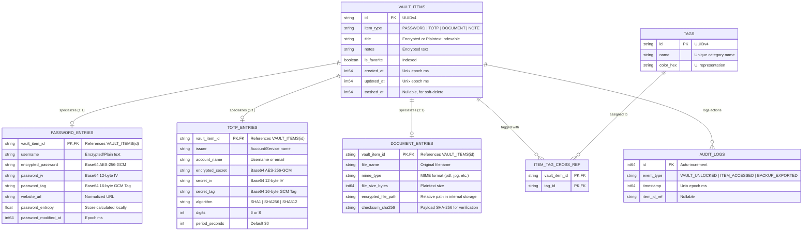
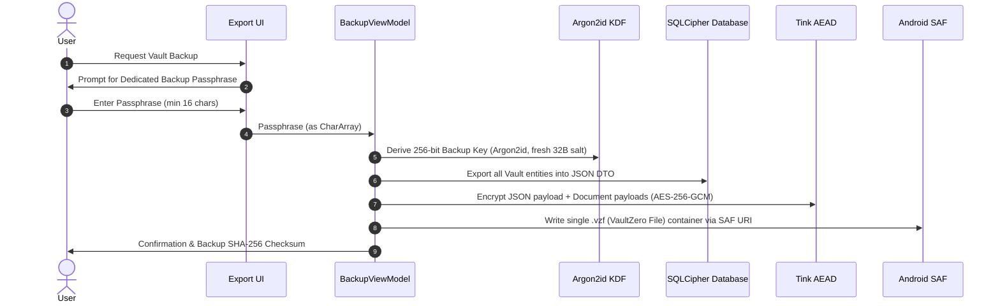

# VaultZero — Architecture Specification

**Version:** 1.0.0-DRAFT  
**Role:** Senior Android Architect, Senior Kotlin Developer, Application Security Engineer  
**Status:** Pending Approval  

---

## 1. System Overview & Architectural Principles

VaultZero is an **offline-first, zero-network personal security vault** running on Android (API 26+ / Android 8.0 through Android 15+). It consolidates:
1. **Password Management**: Categorized credential vault with password generator and breach/entropy analysis.
2. **Secure Document Storage**: File encryption using chunked streaming AEAD with zero data leakage to public storage.
3. **TOTP Authenticator**: RFC 6238 compliant time-based one-time password engine with SHA-1/256/512 support.
4. **Encrypted Backup & Recovery**: Deterministic recovery phrase (BIP-39 style) and encrypted file-based manual export/import via Android Storage Access Framework (SAF).

### 1.1 Strict Constraints & Non-Negotiable Tenets
- **Zero Network Footprint**: The `android.permission.INTERNET` permission is excluded entirely from `AndroidManifest.xml` and stripped from all transitive dependencies via manifest merger rules.
- **Zero Analytics / Zero Telemetry**: No crash-reporting SDKs, ad networks, behavioral tracking, or cloud backup SDKs.
- **Hardware-Enforced Security**: Keys are protected using hardware-backed Android Keystore (TEE / StrongBox Keymaster) wherever hardware allows.
- **Memory Hygiene**: Ephemeral secret data is stored in mutable primitive arrays (`CharArray`, `ByteArray`) and zeroed (`0x00`) immediately after use to mitigate RAM dumps and cold-boot attacks.
- **Surface Defense**: Complete prevention of screen capture (`FLAG_SECURE`), secure clipboard masking (`EXTRA_IS_SENSITIVE`), and background process memory clearance on application suspension.

---

## 2. High-Level Architecture (Clean Architecture + MVVM)

The application follows Google's recommended Modern Android Architecture (MVI/MVVM pattern) guided by Uncle Bob's Clean Architecture principles.

```
+-----------------------------------------------------------------------------------+
|                                 Presentation Layer                                |
|  Jetpack Compose UI  |  Navigation Component  |  ViewModels (StateFlow / UIState) |
|  - Auth / Unlock Screen                       - Password Manager Screens          |
|  - TOTP Authenticator Screens                 - Secure Document Screens           |
|  - Settings & Encrypted Backup/Restore        - Security Audit / Entropy Tools    |
+-----------------------------------------------------------------------------------+
                                          |
                                          v  (Domain Models / Use Cases)
+-----------------------------------------------------------------------------------+
|                                   Domain Layer                                    |
|  - Models: VaultItem, PasswordEntry, TotpEntry, DocumentEntry, BackupPayload       |
|  - UseCases:                                                                      |
|    * UnlockVaultUseCase                       * LockVaultUseCase                  |
|    * GenerateTotpCodeUseCase                  * EncryptAndStoreDocumentUseCase    |
|    * DecryptDocumentUseCase                   * ExportEncryptedBackupUseCase      |
|    * ImportEncryptedBackupUseCase             * EvaluatePasswordEntropyUseCase    |
|  - Repositories (Interfaces):                                                     |
|    * VaultRepository                          * DocumentRepository                |
|    * KeystoreRepository                       * BackupRepository                  |
+-----------------------------------------------------------------------------------+
                                          |
                                          v  (Repository Implementations)
+-----------------------------------------------------------------------------------+
|                                    Data Layer                                     |
|  +---------------------------+  +--------------------------+  +-----------------+ |
|  |     Encrypted Database    |  |   Encrypted File Store   |  | Keystore Engine | |
|  | (Room + SQLCipher 4.x)    |  | (Tink Streaming AEAD)    |  | (Android Key-   | |
|  | - VaultItemDao            |  | - Internal Storage files |  |  store + TEE /  | |
|  | - PasswordDao             |  | - Chunked AES-256-GCM    |  |  StrongBox)     | |
|  | - TotpDao                 |  |                          |  | - Biometric     | |
|  | - DocumentMetadataDao     |  |                          |  |   CryptoObject  | |
|  +---------------------------+  +--------------------------+  +-----------------+ |
+-----------------------------------------------------------------------------------+
                                          |
                                          v
+-----------------------------------------------------------------------------------+
|                                   Core / Security                                 |
|  - Cryptographic Primitives: Argon2id KDF, AES-256-GCM, SecureRandom              |
|  - Biometric Manager (AndroidX BiometricPrompt + CryptoObject)                    |
|  - AutoLock Timer & Lifecycle Watcher (ProcessLifecycleOwner)                     |
|  - Secure Clipboard Controller (Auto-clear timer + Android 13+ Sensitive Masking) |
|  - Memory Zeroizer Utilities                                                      |
+-----------------------------------------------------------------------------------+
```

---

## 3. Database Architecture (Room + SQLCipher)

### 3.1 Technology Choice & Integration
- **Engine**: SQLite encrypted with **SQLCipher 4.5.5+** (Zetetic) using 256-bit AES in CBC mode with HMAC-SHA512 integrity checks and 256,000 PBKDF2 iterations for raw database key stretching (or raw master key pass-through).
- **ORM**: AndroidX Room (2.6.x) configured with `SupportOpenHelperFactory` from SQLCipher.
- **Key Passing**: The 256-bit database encryption key (DBK) is derived from the Master Key in memory upon successful vault unlock and provided to `SupportOpenHelperFactory(passphrase)` as a `ByteArray`.

### 3.2 Database Schema & ER Diagram



### 3.3 SQLCipher Database Security Configuration
During initialization, the database applies strict cipher pragmas:
- `PRAGMA cipher_page_size = 4096;`
- `PRAGMA kdf_iter = 256000;`
- `PRAGMA cipher_hmac_algorithm = HMAC_SHA512;`
- `PRAGMA cipher_default_kdf_algorithm = PBKDF2_HMAC_SHA512;`
- `PRAGMA auto_vacuum = FULL;` (Eliminates residual cryptographic remnants upon deletion).

---

## 4. Package Structure (Modular Architecture)

VaultZero is structured using a package-by-feature / layered modular pattern designed for strict separation of concerns, high testability, and isolated cryptographic boundaries:

```
com.vaultzero.android
│
├── core
│   ├── common
│   │   ├── result               # Result<T>, Error types
│   │   ├── extensions           # ByteArray, CharArray, Flow extensions
│   │   └── dispatcher           # CoroutineDispatchers (IO, Default, Main)
│   │
│   ├── crypto
│   │   ├── engine               # Tink wrappers, AES-GCM, Streaming AEAD
│   │   ├── kdf                  # Argon2id implementation & salt generators
│   │   ├── keystore             # AndroidKeyStoreProvider, StrongBox manager
│   │   ├── biometric            # BiometricCryptoManager, CryptoObject bridge
│   │   ├── memory               # SecureMemory, ZeroizeUtils
│   │   ├── totp                 # RFC 6238 TOTP computation engine
│   │   └── entropy              # Password strength & Shannon entropy calculator
│   │
│   ├── database
│   │   ├── entity               # Room Entities (VaultItem, Password, TOTP, etc.)
│   │   ├── dao                  # Data Access Objects
│   │   ├── converter            # Room TypeConverters
│   │   └── VaultDatabase.kt     # RoomDatabase with SQLCipher open helper
│   │
│   ├── storage
│   │   ├── EncryptedFileStorage # Document stream reader/writer
│   │   └── SafManager           # Storage Access Framework bridge (export/import)
│   │
│   └── security
│       ├── autolock             # Inactivity timer, ScreenOffReceiver, AppLifecycleWatcher
│       ├── clipboard            # SecureClipboardManager (auto-clear, API 33 flag)
│       └── root                 # Local tamper & root heuristic indicators
│
├── data
│   ├── repository
│   │   ├── VaultRepositoryImpl.kt
│   │   ├── DocumentRepositoryImpl.kt
│   │   ├── KeystoreRepositoryImpl.kt
│   │   └── BackupRepositoryImpl.kt
│   └── mapper                   # Entity <-> Domain model mappers
│
├── domain
│   ├── model                    # Domain entities (VaultItem, Credentials, Totp, Doc)
│   ├── repository               # Interfaces for repositories
│   └── usecase
│       ├── auth                 # UnlockWithPasswordUseCase, UnlockWithBiometricUseCase
│       ├── vault                # GetVaultItemsUseCase, SavePasswordUseCase, etc.
│       ├── totp                 # CalculateTotpCodeUseCase
│       ├── document             # EncryptDocumentUseCase, DecryptDocumentUseCase
│       └── backup               # CreateEncryptedBackupUseCase, RestoreBackupUseCase
│
└── presentation
    ├── theme                    # Compose Color, Type, Shape (Material 3)
    ├── navigation               # Compose Navigation graphs, Safe-args routes
    ├── components               # Reusable UI widgets (PIN pad, StrengthBar, SearchBar)
    ├── auth
    │   ├── unlock               # Master password & biometric unlock screen
    │   └── setup                # Initial vault creation & Master Key setup
    ├── passwords
    │   ├── list                 # Filterable / searchable password list
    │   ├── detail               # Secure password viewer (tap to reveal, copy)
    │   └── editor               # Add / edit password with integrated generator
    ├── totp
    │   ├── list                 # Auto-refreshing 30s countdown TOTP cards
    │   └── scanner              # Offline QR scanner (ML Kit barcode / ZXing offline)
    ├── documents
    │   ├── list                 # Document gallery
    │   └── viewer               # Decrypted in-memory viewer (PDF/Image)
    ├── backup
    │   ├── export               # SAF encrypted export UI
    │   └── restore              # SAF restore & recovery phrase verification
    └── settings
        └── security             # Auto-lock delay, biometric toggle, wipe vault
```

---

## 5. Third-Party Library Selection & Compatibility Matrix

All dependencies are vetted for:
1. Complete offline capability (no transitive internet requirements).
2. Industry-standard security maintenance and active provenance.
3. Android 14/15 (API 34/35) compatibility.

| Component | Library & Coordinate | Version | Rationale |
| :--- | :--- | :--- | :--- |
| **Language & Concurrency** | `org.jetbrains.kotlinx:kotlinx-coroutines-android` | `1.8.1` | Asynchronous I/O without thread blocking. |
| **UI Framework** | `androidx.compose:compose-bom` | `2024.05.00` | Modern, declarative, reactive UI; zero reflection. |
| **Encrypted Database** | `net.zetetic:sqlcipher-android` | `4.5.5` | Standard 256-bit AES SQLite encryption engine. |
| **Database ORM** | `androidx.room:room-runtime`, `room-ktx`, `room-compiler` | `2.6.1` | Native Android ORM with SQLCipher `SupportOpenHelperFactory`. |
| **Cryptographic Toolkit** | `com.google.crypto.tink:tink-android` | `1.13.0` | Google's misuse-resistant cryptography for Streaming AEAD & AES-GCM. |
| **Key Derivation (KDF)** | `com.lambdapioneer.argon2kt:argon2kt` | `1.6.0` | High-performance C-native Argon2id binding for Android; zero network. |
| **Biometric Auth** | `androidx.biometric:biometric` | `1.2.0-alpha05` | Modern `BiometricPrompt` with `CryptoObject` hardware binding. |
| **Lifecycle & Auto-Lock**| `androidx.lifecycle:lifecycle-process` | `2.8.1` | Application-level foreground/background transition tracking. |
| **Offline QR / Barcode** | `com.journeyapps:zxing-android-embedded` | `4.3.0` | Completely offline camera QR code reader for TOTP setup. |
| **Unit Testing** | `org.junit.jupiter:junit-jupiter` | `5.10.2` | JUnit 5 testing engine for unit tests. |
| **Mocking** | `io.mockk:mockk` | `1.13.11` | Pure Kotlin mocking library. |
| **Flow Testing** | `app.cash.turbine:turbine` | `1.1.0` | Flow verification library for Kotlin Coroutines. |
| **Robolectric** | `org.robolectric:robolectric` | `4.12.2` | Fast JVM-based Android framework unit testing. |

---

## 6. Secure Document Storage Design

To prevent out-of-memory errors (OOM) and heap scraping when handling large documents (PDFs, images up to 50MB):

1. **Chunked Streaming Encryption**:
   - Uses Tink's `StreamingAead` (`AesGcmHkdfStreaming`) with:
     - Main key size: 32 bytes (256-bit).
     - HKDF hash: SHA-256.
     - Segment size: 64 KB per authenticated chunk.
2. **Encrypted Storage Directory**:
   - Located exclusively in `context.noBackupFilesDir.resolve("vault_docs")`.
   - Never stored on external storage or public media directories.
3. **Decryption on Demand**:
   - Files are decrypted on-the-fly directly to a secure stream or temp memory buffer only when being viewed.
   - Any temporary decrypted file created for viewing via OS Intent (if unavoidable) is placed in private cache with `File.deleteOnExit()` and zeroized upon activity destruction.

---

## 7. TOTP Implementation Design (RFC 6238)

To avoid heavy external dependencies for 2FA, VaultZero implements RFC 6238 natively using Kotlin and standard Java Cryptography Architecture (`javax.crypto.Mac`):

1. **Algorithm Flow**:
   $$\text{Counter } C = \left\lfloor \frac{T - T_0}{X} \right\rfloor$$
   where $T$ is the current UNIX timestamp, $T_0 = 0$, and $X$ is the step (default 30 seconds).
2. **HMAC Calculation**:
   - Key: Decrypted Base32-decoded secret.
   - Hash: `HmacSHA1`, `HmacSHA256`, or `HmacSHA512` based on entry configuration.
3. **Dynamic Truncation**:
   - Extracts a 4-byte dynamic binary code from the HMAC output based on the last 4 bits of the hash.
   - Computes $Code = \text{BinaryCode} \pmod{10^{\text{digits}}}$.
   - Padded with leading zeros to maintain 6 or 8 digits.
4. **Time Skew Tolerant Verification**:
   - Internal clock drift is bounded; UI displays a smooth 30-second progress ring with exact seconds remaining.

---

## 8. Encrypted Backup and Recovery Design

### 8.1 Export Flow


### 8.2 Backup File Format (`.vzf`)
The backup file is a binary envelope:
- `Bytes 0..7`: Magic header (`"VAULT001"`)
- `Bytes 8..39`: 32-byte Argon2id Salt
- `Bytes 40..55`: 16-byte KDF Parameters (Iterations, Memory KiB, Parallelism)
- `Bytes 56..67`: 12-byte AES-GCM IV / Nonce
- `Bytes 68..End`: Ciphertext + 16-byte GCM Tag containing compressed ZIP archive of DB JSON + encrypted documents.

---

## 9. Development Roadmap

```
+------------------------------------------------------------------------------------+
|                               PHASED EXECUTION ROADMAP                             |
+------------------------------------------------------------------------------------+
| Phase 1: Cryptographic Core & Security Foundations                                 |
| - Argon2id KDF engine + Hardware Android Keystore binding                          |
| - Master Key generation, wrapping & biometric CryptoObject integration             |
| - Memory zeroization and secure primitive handling utilities                      |
| - Pure JUnit 5 crypto unit tests & test vectors (RFC 6238, AES-GCM, Argon2)        |
+------------------------------------------------------------------------------------+
| Phase 2: Secure Database & File Storage Layer                                      |
| - SQLCipher 4.5.5 + Room 2.6.1 integration with cipher pragmas                     |
| - Entity models, DAOs, and database migration infrastructure                       |
| - Tink Streaming AEAD file storage for encrypted documents                         |
| - Data layer integration tests with in-memory SQLCipher                            |
+------------------------------------------------------------------------------------+
| Phase 3: Vault Authentication & Lifecycle Guarding                                 |
| - Initial Vault Setup Flow (Master Password + BIP-39 Recovery Phrase generation)   |
| - Biometric prompt unlock & fallback master password UI                            |
| - AutoLockManager: Inactivity timer, Screen-off listener, ProcessLifecycleObserver |
| - Anti-screenshot / FLAG_SECURE enforcement                                       |
+------------------------------------------------------------------------------------+
| Phase 4: Core Vault Features (Passwords & TOTP)                                    |
| - Password Manager: List, Search, Detail, Generator, Entropy Scorer                |
| - Secure Clipboard: Android 13+ Sensitive flag, auto-clear coroutine service       |
| - TOTP Authenticator: Offline QR scanner, 30s countdown loop, HMAC engine           |
+------------------------------------------------------------------------------------+
| Phase 5: Secure Document Storage UI & SAF Backup/Restore                           |
| - Document picker via SAF, encrypted chunked ingestion, thumbnail-free viewer     |
| - Encrypted Manual Backup export (.vzf) & verification                             |
| - Full vault restore & recovery phrase disaster recovery workflow                  |
+------------------------------------------------------------------------------------+
| Phase 6: Hardening, Static Analysis & Audit Verification                           |
| - Android Lint, Detekt, Dependency Vulnerability Scanning                          |
| - Memory leak & RAM snapshot inspection (verifying zeroized keys)                  |
| - End-to-end user acceptance and stress testing                                    |
+------------------------------------------------------------------------------------+
```
