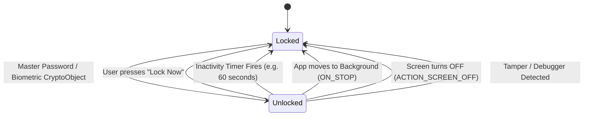

# VaultZero — Security Design & Threat Model

**Version:** 1.0.0-DRAFT  
**Author:** Senior Application Security Engineer & Android Architect  
**Classification:** Restricted / Security Engineering  
**Status:** Pending Approval  

---

## 1. Threat Modeling (STRIDE / OWASP Mobile Top 10)

VaultZero operates under the assumption of an **adversarial local environment**. Because the application is strictly offline and has no remote attack surface, the primary threats originate from local physical access, unauthorized applications running on the same OS, compromised memory, and device theft.

### 1.1 Threat Matrix & Mitigations

| Threat ID | Threat Category | Attack Vector / Scenario | Severity | Mitigation in VaultZero |
| :--- | :--- | :--- | :--- | :--- |
| **TH-01** | **Information Disclosure** | Other apps snooping on background previews in Android recent apps switcher. | High | `Window.setFlags(FLAG_SECURE, FLAG_SECURE)` applied across all Activity windows, preventing snapshots, screen recording, and system switcher caching. |
| **TH-02** | **Information Disclosure** | Malicious background keyboard or clipboard listener reading copied credentials. | Critical | (1) Use `ClipDescription.EXTRA_IS_SENSITIVE` (API 33+) to mask notifications and disable cloud clipboard sync.<br>(2) Foreground coroutine timer that wipes the clipboard after 30 seconds. |
| **TH-03** | **Elevation of Privilege** | Attacker adds their own fingerprint to an unlocked device to gain vault entry. | Critical | Biometric Keystore key configured with `.setInvalidatedByBiometricEnrollment(true)`. Adding a new biometric automatically destroys the key, forcing Master Password entry. |
| **TH-04** | **Memory Inspection** | Forensic memory dumping (RAM dump, cold-boot attack, or JDWP debugger attachment). | High | (1) Master keys and plaintexts held only in `CharArray` / `ByteArray` and immediately zeroized (`Arrays.fill(0)`).<br>(2) Memory wiped on application backgrounding or timeout.<br>(3) Release builds disable `android:debuggable`. |
| **TH-05** | **Tampering / Extraction** | Extraction of app database via Android Debug Bridge (`adb backup`). | High | Set `android:allowBackup="false"`, `android:fullBackupContent="false"`, and configure explicit `dataExtractionRules` rejecting cloud/device transfers. |
| **TH-06** | **Brute-Force Attack** | Offline brute-force dictionary attack on stolen database or encrypted backup. | Critical | High-cost **Argon2id** Key Derivation Function (KDF) parameterized to consume 64MB RAM and multiple iterations, rendering GPU/ASIC acceleration computationally prohibitive. |
| **TH-07** | **Inadvertent Data Leak** | Android OS caching temporary decrypted files or logs to disk. | High | (1) Documents decrypted in-memory directly to streams.<br>(2) Zero log statements (`Log.d`, `Log.v`) emitting credential material.<br>(3) ProGuard/R8 rules strip all logging bytecode in release builds. |
| **TH-08** | **Biometric Bypass** | Rooted device hooks `onAuthenticationSucceeded` via Frida or Xposed. | Critical | Biometric authentication is **cryptographically bound**: `BiometricPrompt` must unlock a hardware-backed `Cipher` inside `CryptoObject`. A spoofed callback fails because the decryption cipher is never unlocked. |

---

## 2. Cryptographic Key Hierarchy

The cryptographic foundation of VaultZero uses a layered key envelope pattern to isolate responsibilities and allow password changes or biometric re-enrollment without re-encrypting the underlying database or stored documents.

```
                           +---------------------------+
                           |   User Master Password    |
                           +---------------------------+
                                         |
                                         v
                         Argon2id KDF (64MB, t=3, p=4)
                                  + 32B Salt
                                         |
                                         v
                           +---------------------------+
                           |  Password-derived KEK     |
                           |       (256-bit AES)       |
                           +---------------------------+
                                         |
                                         v
                        Unwraps (AES-256-GCM Decrypt)
                                         |
    +-------------------------+          |          +-------------------------+
    | Android Keystore (TEE)  |          |          |   BIP-39 Recovery Key   |
    |  Biometric Key (KMK)    |          |          |  (24-word Mnemonic KEK) |
    +-------------------------+          |          +-------------------------+
                 |                       |                       |
      Unwraps via CryptoObject           |             Unwraps (Emergency)
                 |                       v                       |
                 +----------------> [ Master Key ] <-------------+
                                    (256-bit AES)
                                    (Random CSPRNG)
                                         |
               +-------------------------+-------------------------+
               |                                                   |
      HKDF-SHA256 Expand                                  HKDF-SHA256 Expand
   info: "VaultZero_DBK_v1"                            info: "VaultZero_DEK_v1"
               |                                                   |
               v                                                   v
+-------------------------------+                   +-------------------------------+
|   Database Key (DBK) (256b)   |                   | Document Encryption Key (DEK) |
|     (SQLCipher Database)      |                   |   (Tink Streaming AEAD GCM)   |
+-------------------------------+                   +-------------------------------+
```

### 2.1 Key Definitions & Lifecycles

1. **Master Key (MK)**:
   - **Type**: 256-bit symmetric key (`AES-256`).
   - **Generation**: Generated once at vault creation via `java.security.SecureRandom`.
   - **Storage**: Never persisted in plaintext. Stored on disk in two wrapped forms:
     - `wrapped_mk_pwd`: Encrypted with password-derived KEK using AES-256-GCM.
     - `wrapped_mk_bio`: Encrypted with Android Keystore biometric key using AES-256-GCM.
     - `wrapped_mk_rec`: Encrypted with BIP-39 derived recovery key.
   - **Lifecycle**: Loaded into memory upon successful authentication; destroyed and zeroized upon vault lock.

2. **Password Key Encryption Key ($KEK_{pwd}$)**:
   - **Type**: 256-bit AES key.
   - **Derivation**: Derived from the user's Master Password using **Argon2id**.
   - **Parameters**: Memory: 65,536 KiB (64 MiB), Iterations: 3, Parallelism: 4, Salt: 32 bytes CSPRNG.

3. **Biometric Key ($KMK_{bio}$)**:
   - **Type**: 256-bit AES key in Android Keystore.
   - **Storage**: Hardware Security Module (StrongBox if supported, else TEE).
   - **Access Control**: `KeyProperties.AUTH_BIOMETRIC_STRONG`, requiring user authentication per operation (`setUserAuthenticationRequired(true)`).
   - **Invalidation**: `setInvalidatedByBiometricEnrollment(true)`.

4. **Database Key (DBK)**:
   - **Derivation**: Derived from Master Key using HKDF-SHA256 with info `"VaultZero_DBK_v1"`.
   - **Usage**: Passed directly as raw key bytes to SQLCipher `SupportOpenHelperFactory`.

5. **Document Encryption Key (DEK)**:
   - **Derivation**: Derived from Master Key using HKDF-SHA256 with info `"VaultZero_DEK_v1"`.
   - **Usage**: Used by Google Tink `StreamingAead` (`AesGcmHkdfStreaming`) to encrypt and decrypt chunked files.

6. **Emergency Recovery Key ($KEK_{rec}$)**:
   - **Type**: 256-bit key derived from a 24-word BIP-39 mnemonic phrase generated at vault initialization.
   - **Usage**: Allows the user to reset their Master Password without losing existing encrypted data.

---

## 3. Cryptographic Primitives & Specifications

To ensure strict compliance with modern cryptographic standards, all algorithms and configurations follow NIST and OWASP specifications:

| Primitive | Standard / Algorithm | Parameters / Configuration | Justification |
| :--- | :--- | :--- | :--- |
| **Password Hashing / KDF** | Argon2id | Memory: 64MB, Iterations: 3, Parallelism: 4, Salt: 256 bits | Winner of Password Hashing Competition; resistant to GPU and side-channel attacks. |
| **Field-Level Encryption** | AES-256-GCM | 256-bit key, 96-bit (12-byte) unique IV, 128-bit (16-byte) auth tag | Authenticated encryption prevents tampering and ciphertext modification. |
| **Document Encryption** | Tink `AesGcmHkdfStreaming` | 256-bit key, 64KB chunk size, HKDF-SHA256 | Prevents memory exhaustion on large files; detects truncation and reordering attacks. |
| **Database Encryption** | SQLCipher 4.5.5+ | 256-bit AES-CBC with HMAC-SHA512 integrity, 4096-byte pages | Industry-standard mobile encrypted relational storage engine. |
| **RNG (Random Numbers)** | `SecureRandom` | Native Linux `/dev/urandom` / Hardware TRNG backing | Cryptographically secure pseudo-random number generator for salts and IVs. |
| **TOTP Generator** | RFC 6238 / RFC 4226 | HMAC-SHA1 / HMAC-SHA256 / HMAC-SHA512, 30s step, 6-8 digits | Universal multi-factor authentication standard. |

---

## 4. Biometric Authentication Architecture

### 4.1 Cryptographic CryptoObject Binding
Many insecure applications authenticate biometrics by registering a simple callback:
```kotlin
// INSECURE PATTERN - DO NOT USE
override fun onAuthenticationSucceeded(result: BiometricPrompt.AuthenticationResult) {
    unlockVault() // VULNERABLE TO MEMORY HOOKING
}
```

VaultZero enforces **Hardware-Bound CryptoObject Authentication**:
```kotlin
// SECURE PATTERN - IMPLEMENTED IN VAULTZERO
val cipher = biometricCryptoManager.getDecryptCipher() // Initialized with Keystore KMK_bio
val cryptoObject = BiometricPrompt.CryptoObject(cipher)

biometricPrompt.authenticate(promptInfo, cryptoObject)

override fun onAuthenticationSucceeded(result: BiometricPrompt.AuthenticationResult) {
    val authenticatedCipher = result.cryptoObject?.cipher 
        ?: throw SecurityException("CryptoObject missing!")
    // Use the hardware-unlocked cipher to unwrap the Master Key
    val masterKey = authenticatedCipher.doFinal(wrappedMasterKeyBio)
    vaultManager.unlock(masterKey)
}
```
If an attacker tampers with the application runtime via Frida or Xposed to force `onAuthenticationSucceeded`, the hardware Keystore still refuses to provide the decrypted cipher stream. The attack fails deterministically.

---

## 5. In-Memory Security & Zeroization

### 5.1 Immutable String Avoidance
Java `java.lang.String` objects are immutable and placed in the JVM String Intern Pool, remaining in heap memory indefinitely until unpredictable Garbage Collection cycles occur.
- **Rule**: All sensitive inputs (passwords, TOTP secrets, keys, mnemonic words) are captured and processed exclusively as `CharArray` or `ByteArray`.
- **Zeroization Pattern**:
```kotlin
fun zeroize(bytes: ByteArray) {
    java.util.Arrays.fill(bytes, 0.toByte())
}

fun zeroize(chars: CharArray) {
    java.util.Arrays.fill(chars, '\u0000')
}
```
- **Lifecycle Guarantees**:
  - `MasterKey` holder implements `AutoCloseable` and zeroes internal byte arrays upon `close()`.
  - When the vault is locked or the process transitions to background, the memory holder is explicitly closed.

---

## 6. Secure Clipboard Management

1. **Android 13+ (API 33+) Sensitive Content Masking**:
   When copying passwords or TOTP codes, VaultZero marks the clipboard payload with `ClipDescription.EXTRA_IS_SENSITIVE`:
   ```kotlin
   val clipData = ClipData.newPlainText("Password", secretText).apply {
       description.extras = PersistableBundle().apply {
           putBoolean(ClipDescription.EXTRA_IS_SENSITIVE, true)
       }
   }
   clipboardManager.setPrimaryClip(clipData)
   ```
   This instructs the OS to:
   - Suppress on-screen clipboard preview notifications.
   - Prevent clipboard synchronization to connected tablets/computers or cloud clipboard clipboards.

2. **Automated Clipboard Purging**:
   - VaultZero schedules a cancellable coroutine timer (default: 30 seconds).
   - Upon timer expiry, the clipboard is verified: if it still contains VaultZero's clip, it is cleared with `clipboardManager.clearPrimaryClip()` or overwritten with an empty clip.

---

## 7. Automatic Vault Locking & Lifecycle Defenses



### 7.1 Auto-Lock Triggers
1. **Inactivity Timer**: Resets on any user touch event using a Compose interaction tracker or Activity touch interception.
2. **Process Lifecycle**: Monitored via `DefaultLifecycleObserver` registered on `ProcessLifecycleOwner.get().lifecycle`. Moving to `ON_STOP` triggers immediate key destruction.
3. **Screen Off Broadcast**: A dynamic `BroadcastReceiver` listening for `Intent.ACTION_SCREEN_OFF` ensures immediate locking when the physical power button is pressed.
4. **Zeroization on Lock**: Locking invalidates Room database connections, unloads the DBK, and overwrites the Master Key array with zeros.

---

## 8. Encrypted Backup Specification (`.vzf`)

To allow offline migration between devices without compromising security:
1. **Format**: VaultZero Encrypted Container (`.vzf`).
2. **KDF**: Argon2id (Salt: 32 bytes, Memory: 64MB, Iterations: 3) derived from an **explicit user backup passphrase** (distinct from device master password).
3. **Envelope Encryption**:
   - Header: Magic `"VAULT001"` (8 bytes)
   - KDF Parameters: Salt (32 bytes) + Iterations/Mem (16 bytes)
   - AES-GCM IV: 12 bytes
   - Ciphertext + GCM Tag (16 bytes): Encrypted ZIP stream containing:
     - `vault_data.json` (Structured dump of all password and TOTP entities)
     - `documents/` (Encrypted document blobs with integrity hashes)
4. **Transport**: Handled entirely through Android's Storage Access Framework (`ACTION_CREATE_DOCUMENT` / `ACTION_OPEN_DOCUMENT`). No temporary files written to external storage.
